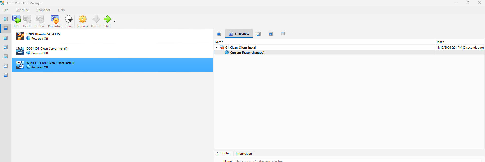
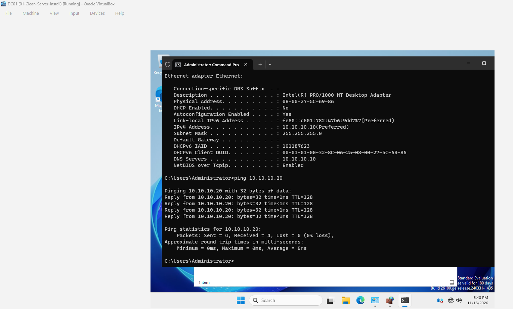
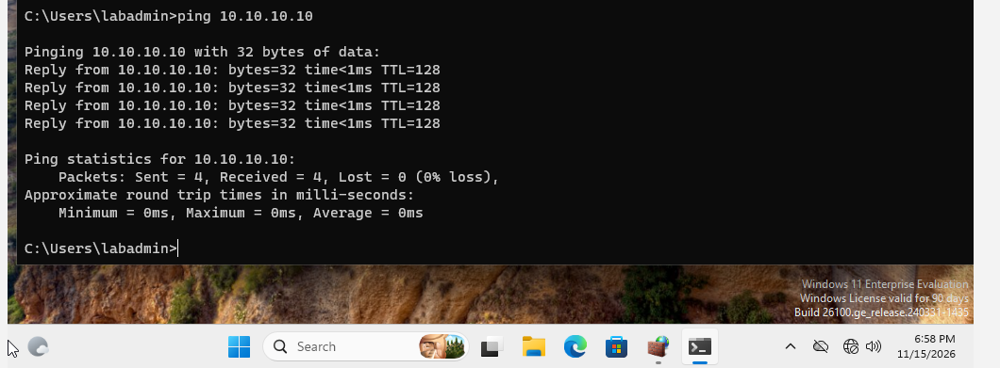

# Enterprise Active Directory & IT Help Desk Home Lab

A hands-on IT support lab for a fictional company of approximately 25 employees.

## Current status

DC01 and WIN11-01 are installed and activated, with baseline snapshots. Both active VirtualBox adapters use the isolated Internal Network LabNet; screenshots verify static addresses 10.10.10.10/24 and 10.10.10.20/24, respectively. After troubleshooting DC01's duplicate-address state, ping tests initiated from each VM succeed with 4/4 replies and 0% loss. DC01 updates are complete by the lab owner's report; client updates are deferred. Active Directory Users and Computers now shows ad.northstar.example with DC01 as a Global Catalog domain controller. DNS verification is in progress: DNS Manager currently shows no forward lookup zones. Client domain join is pending.

## Planned technologies

- Windows Server 2025, Active Directory Domain Services, and DNS
- A domain-joined Windows 11 workstation
- Organizational units, accounts, security groups, and Group Policy
- File shares and access permissions
- Windows troubleshooting tools and PowerShell
- GLPI and realistic Tier 1 support incidents

## Documentation

- [Setup record](docs/SETUP.md)
- [Troubleshooting knowledge base](docs/TROUBLESHOOTING.md)
- [Screenshot evidence gallery](docs/EVIDENCE.md)

## Evidence of work

Screenshots show installation, virtual hardware, recovery snapshots, addressing, and an actual network troubleshooting case. Evidence captions distinguish successful tests from failures and self-tests.

DC01's address is now Preferred, and its ping to WIN11-01 returns four replies with 0% loss:

WIN11-01 also successfully pings DC01 with 0% loss:

## Lab practices

Use fictional employee data and an isolated lab network. Avoid exposing lab services to the internet and take VM snapshots before risky changes. Documentation will record completed work and verification results. Portfolio material must exclude credentials, license keys, and personal information.
