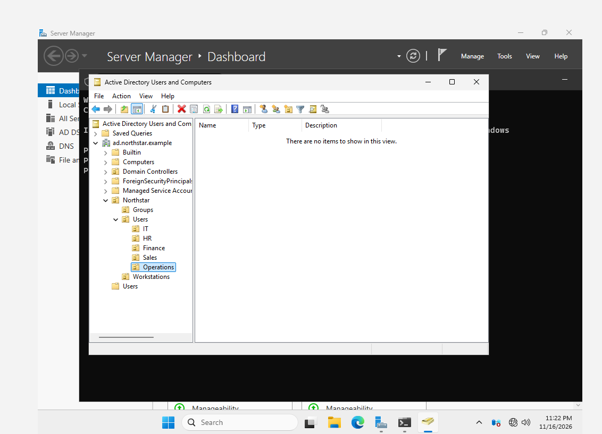

# Northstar directory design

Northstar is a fictional company targeting approximately 25 employees across five departments. OUs organize objects for administration and future Group Policy. Security groups will grant access separately.

Verified structure:

```text
ad.northstar.example
  Northstar
    Groups
    Users
      IT
      HR
      Finance
      Sales
      Operations
    Workstations
```

Accounts will go in department OUs, security groups in Groups, and the client in Workstations after domain join. DC01 stays in Domain Controllers. Accounts, groups, client placement, and policies remain planned.



DNS remains unresolved: automatic and manual domain-zone creation fail with Win32 error 123. Promotion logs show DNS installed but configuration failed. Local AD queries succeed and both DNS partitions report DNS_DP_OKAY. The underlying cause is unknown; client domain join is deferred.

## Employee account checkpoint

The learner supplied Get-ADUser output scoped to OU=Users,OU=Northstar,DC=ad,DC=northstar,DC=example showing 25 unique employee accounts, all Enabled=True. This verifies the count, account names, and enabled state within that subtree. The displayed output does not independently verify individual department placement, password settings, or successful sign-in.

One display name is Isabelle Ross with logon isabella.ross; this is a naming difference from the proposed Isabella Ross, not a demonstrated authentication failure. Security groups and memberships remain pending. DNS remains unresolved.

Follow-up screenshot evidence verifies five user objects in each of IT, HR, Finance, Sales, and Operations. Department placement is now verified in the [evidence gallery](EVIDENCE.md#employee-department-placement). Security-group creation and membership remain unverified.
