# Screenshot Evidence

## Active Directory promotion and DNS investigation

AD Users and Computers shows `ad.northstar.example`, with `DC01` under Domain Controllers and DC Type `GC`. This verifies domain/DC presence, not full DNS health.

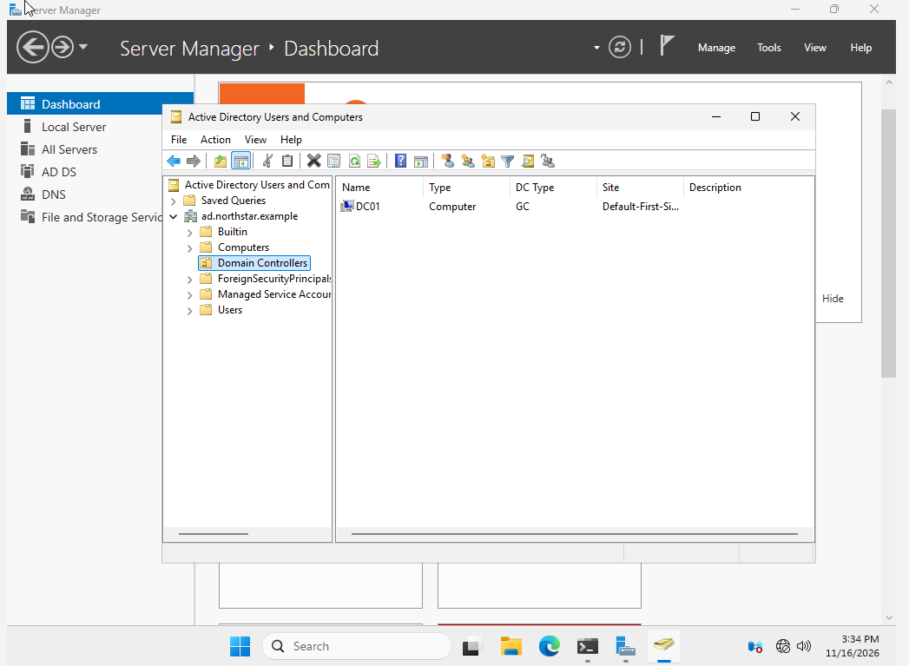

The DNS Manager Forward Lookup Zones view currently shows no zones. Cause and resolution remain under investigation; zone creation is not claimed.

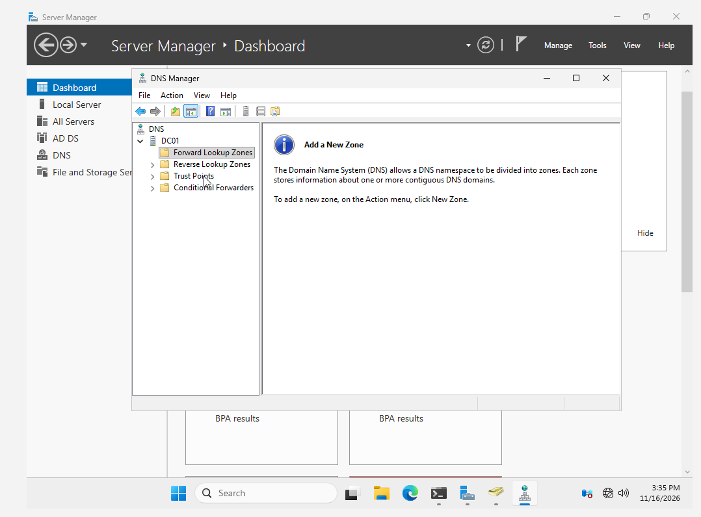

Selected screenshots supplied by the lab owner, reviewed before publication. They show lab machines, fictional/local account names, and private lab addressing. Activation-page screenshots with product identifiers, host personal paths, and unrelated application views are omitted. Images are original screenshots, not recreated outputs. Capture timestamps are not used to infer task order or completion dates.

## Windows Server installation

About Windows identifies Windows Server 2025 Standard Evaluation, version 24H2, build 26100.32230. The graphical session demonstrates Desktop Experience.

## Windows client installation

About Windows identifies Windows 11 Enterprise Evaluation, version 26H2, build 26300.9457. The registered user is labadmin; separate Settings screenshots verified the local account and activation. Client Windows updates were deferred.

## Client virtual hardware

The VM summary verifies 8192 MB RAM, 2 CPUs, TPM 2.0, EFI, Secure Boot, an 80 GB VDI, and attached Enterprise evaluation ISO. NAT shown here is the earlier installation/activation configuration, not the final lab network.

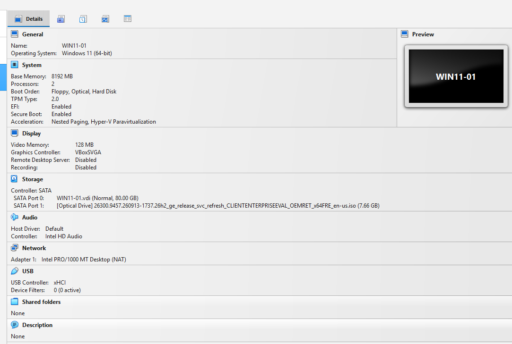

## Recovery snapshots

The replacement screenshot supplied by the lab owner shows the client snapshot 01-Clean-Client-Install and DC01 associated with 01-Clean-Server-Install. Both lab VMs are running in this later capture. Snapshot existence is verified; restoration is untested. The older screenshot with the unrelated university VM label has been replaced in the current gallery.

## Isolated networking

DC01's summary shows adapter 1 attached to Internal Network LabNet. Later read-only inspection of the current configuration for both VMs confirmed their active adapters use LabNet; historical snapshot configurations were excluded from that check.

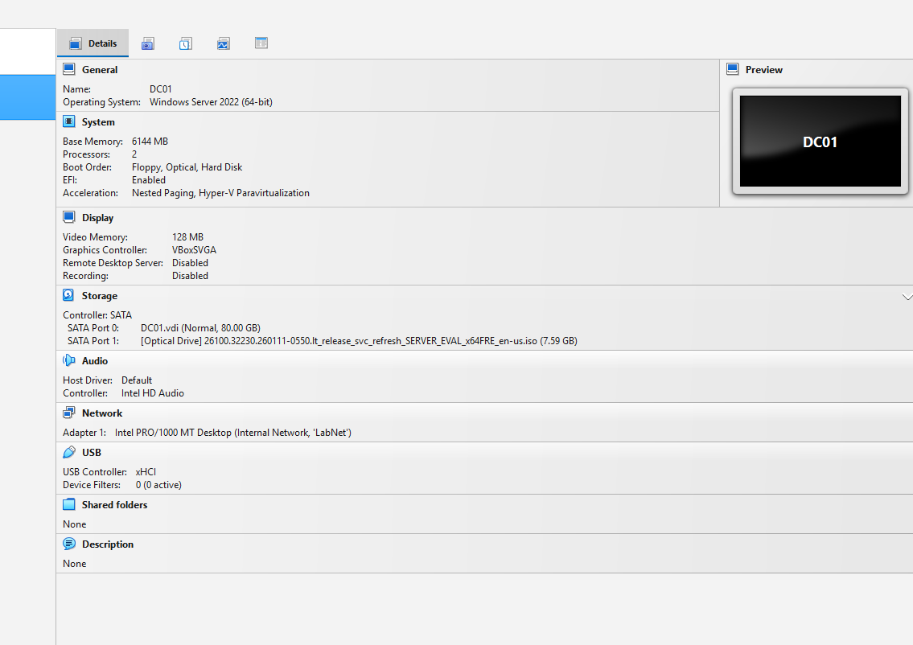

## Client static addressing

WIN11-01's ipconfig /all shows 10.10.10.20 Preferred, mask 255.255.255.0, DHCP disabled, DNS 10.10.10.10, and no gateway. This image alone does not verify reachability.

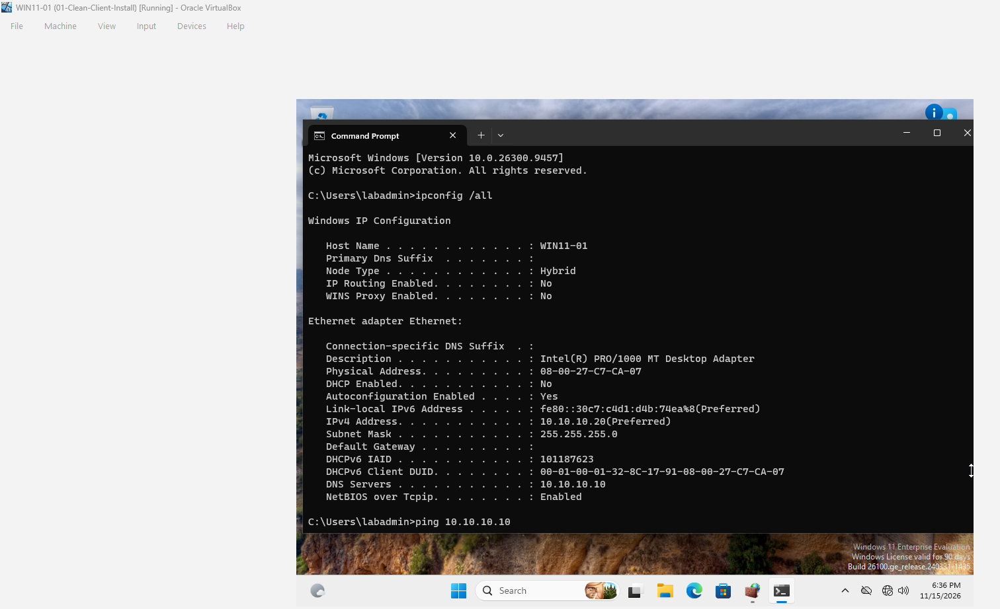

## Troubleshooting: duplicate address and failed reachability

DC01 initially reports 10.10.10.10 Duplicate and an additional 169.254 address. The client test to 10.10.10.10 fails; Destination host unreachable is returned by the client itself, not the server. The source of the detected conflict has not been established.

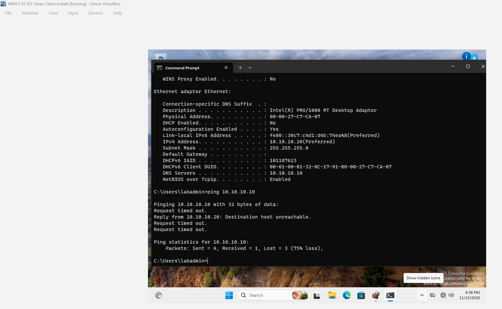

## Recovery: server-to-client success

A subsequent DC01 screenshot shows 10.10.10.10 Preferred and four successful replies from WIN11-01 at 10.10.10.20 with 0% loss. Adapter disable/enable had been suggested; the learner did not explicitly identify which action restored the address, so causation is not claimed.

Fresh server-to-client test: 4 sent, 4 received, 0% loss.

## Client-to-server success

The new client screenshot shows ping 10.10.10.10 receiving four replies from DC01 with 0% loss. Together with the server test above, this verifies successful ICMP tests initiated in both directions. DNS, domain membership, and application services have not been tested yet.

## Earlier verification limit: a self-ping is not a remote connectivity test

This historical client screenshot shows the failed ping to the server followed by a successful ping to its own address 10.10.10.20. The self-ping verified local response only; the subsequent remote test above now supplies the missing client-to-server evidence.

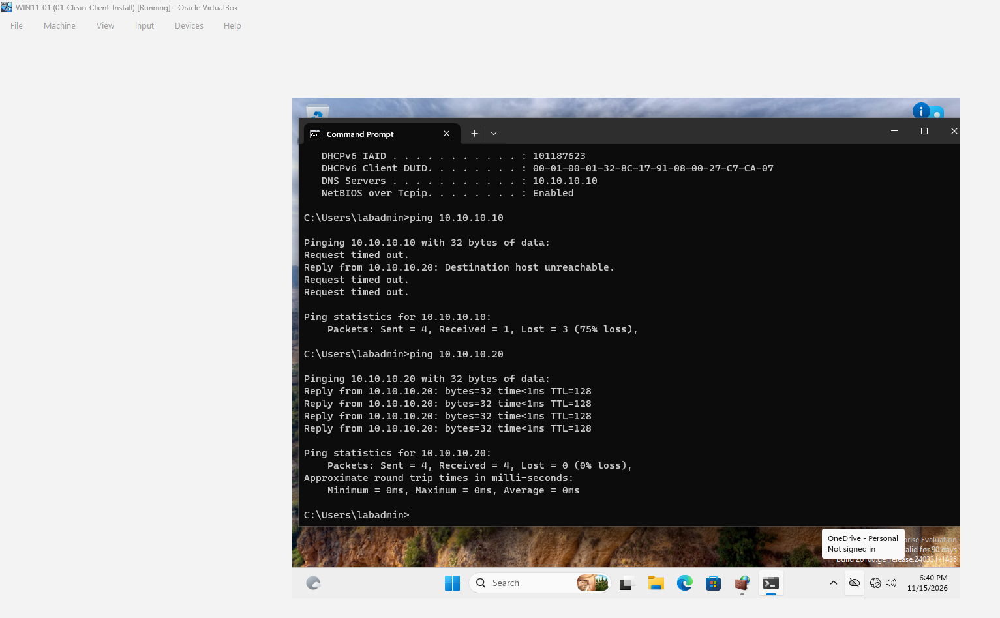

## Department organizational units

The screenshot verifies Northstar contains Groups, Users, and Workstations, with IT, HR, Finance, Sales, and Operations beneath Users. It does not verify accounts, security groups, domain joining, or DNS recovery.

## Employee department placement

Five ADUC screenshots now verify five user objects in each department OU under Northstar/Users. Some long names are visually truncated; the earlier PowerShell output supplies their full names and enabled state. These screenshots verify OU placement, not security-group membership or password flags.

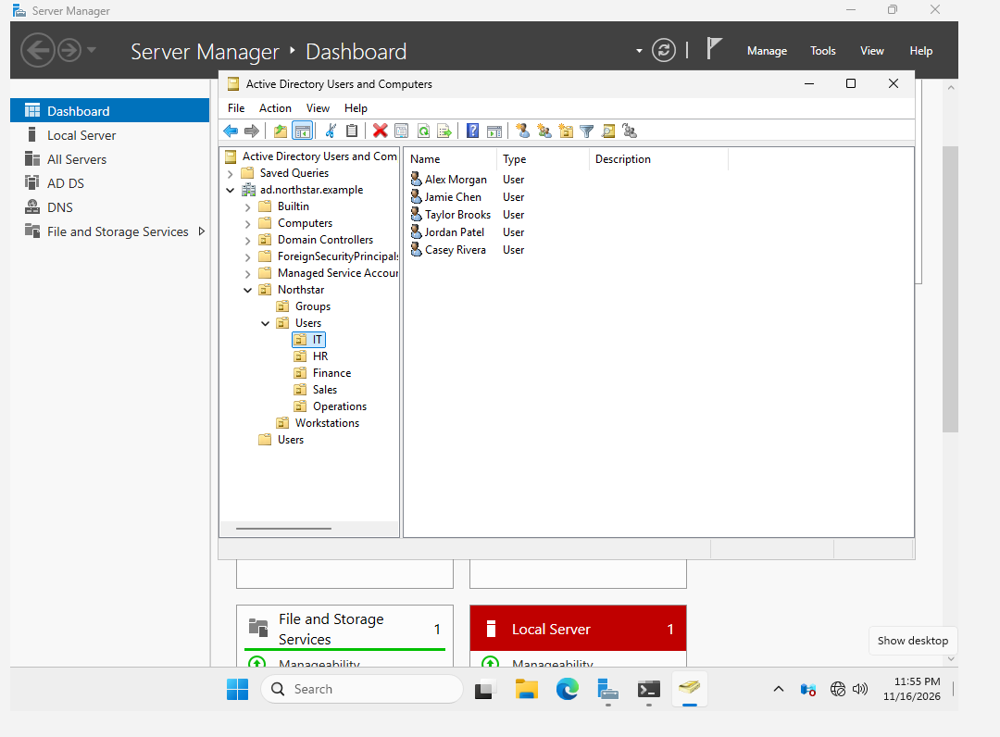

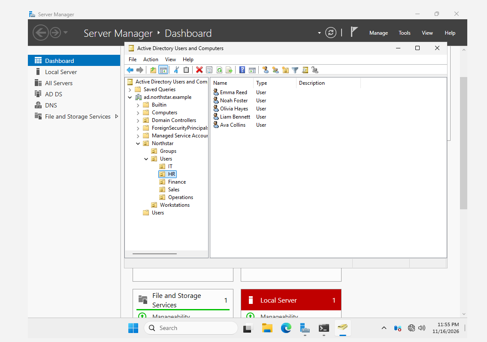

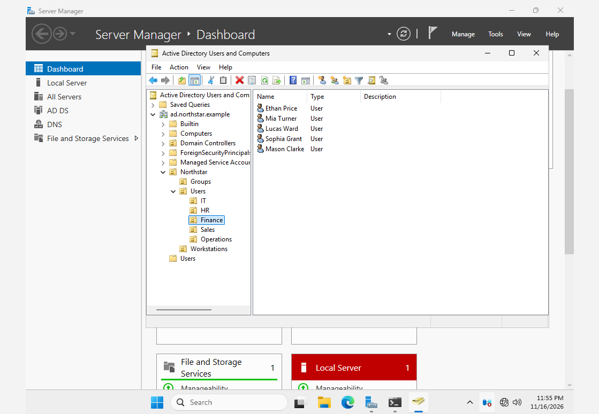

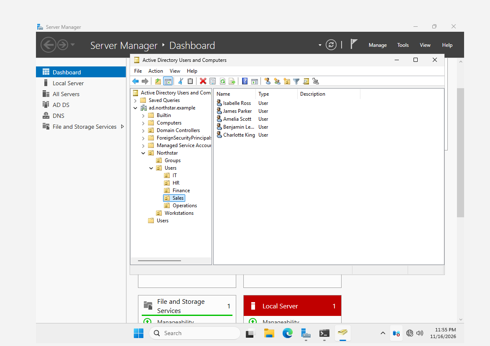

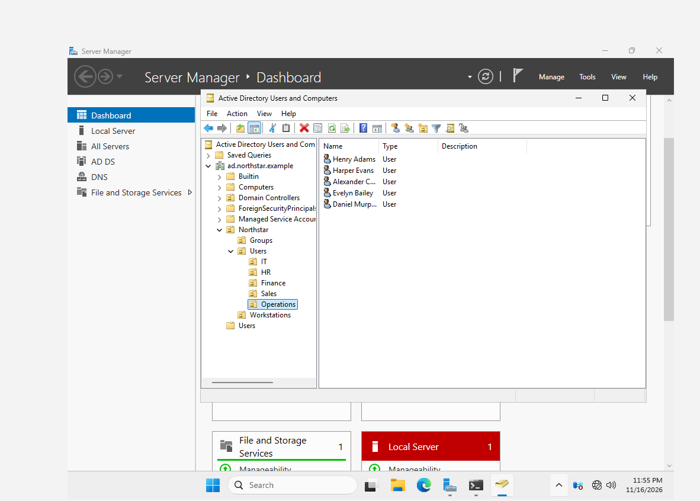

## Department security groups

ADUC screenshot verifies five security-group objects in Northstar/Groups. Finance, HR, IT, and Sales names are visible; the Operations name is truncated. Scope and full Operations name will be checked with membership verification. Membership and access permissions are not yet verified.

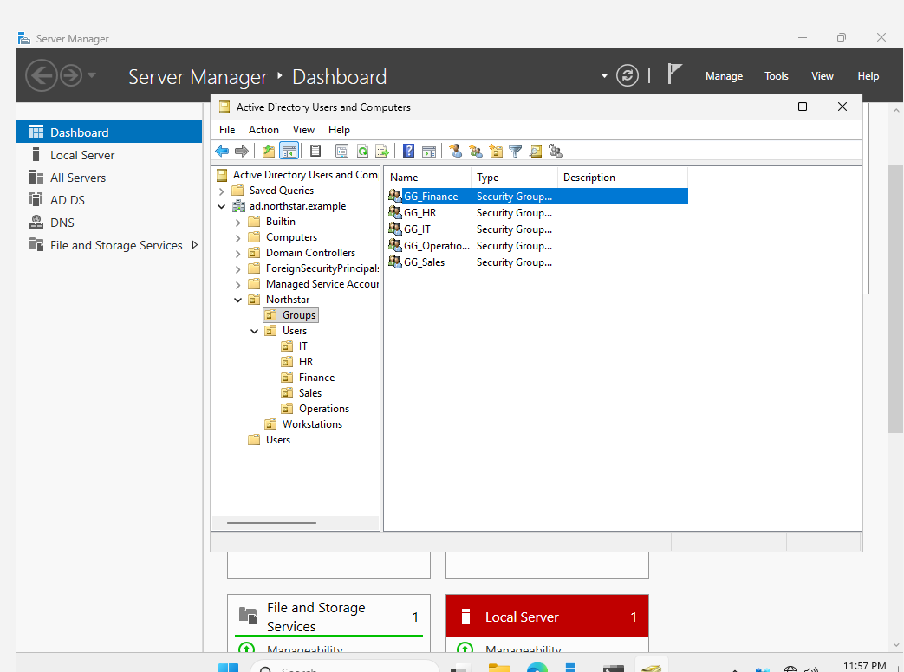

## Verified department memberships

PowerShell output verifies GG_IT, GG_HR, GG_Finance, GG_Sales, and GG_Operations each have Global scope, Security category, and exactly five matching department users. All 25 expected employees are accounted for. Group membership does not itself prove resource permissions or successful domain sign-in.

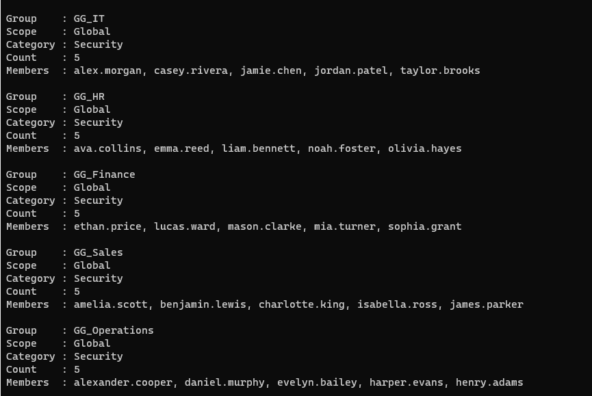

## Password reset verification

ADUC confirms Alex Morgan's password was changed. A subsequent Get-ADUser query shows Enabled=True, pwdLastSet=0 (password change required at next logon), and LockedOut=False. No password is shown. This verifies the reset and account flags; an actual lockout/unlock and client sign-in have not been demonstrated.

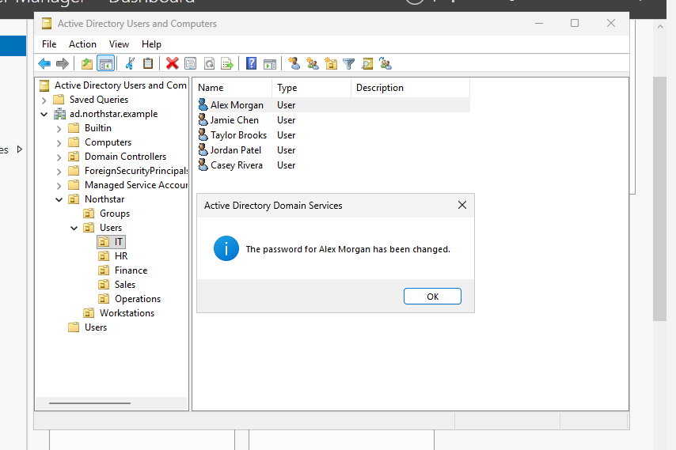

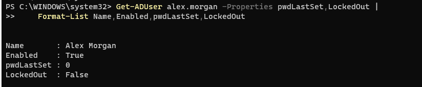
