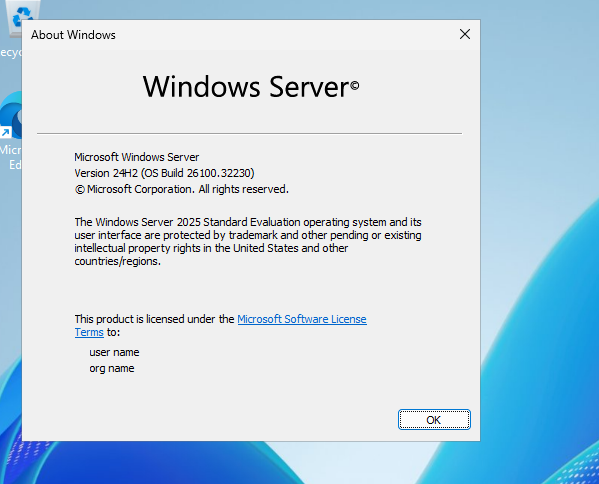
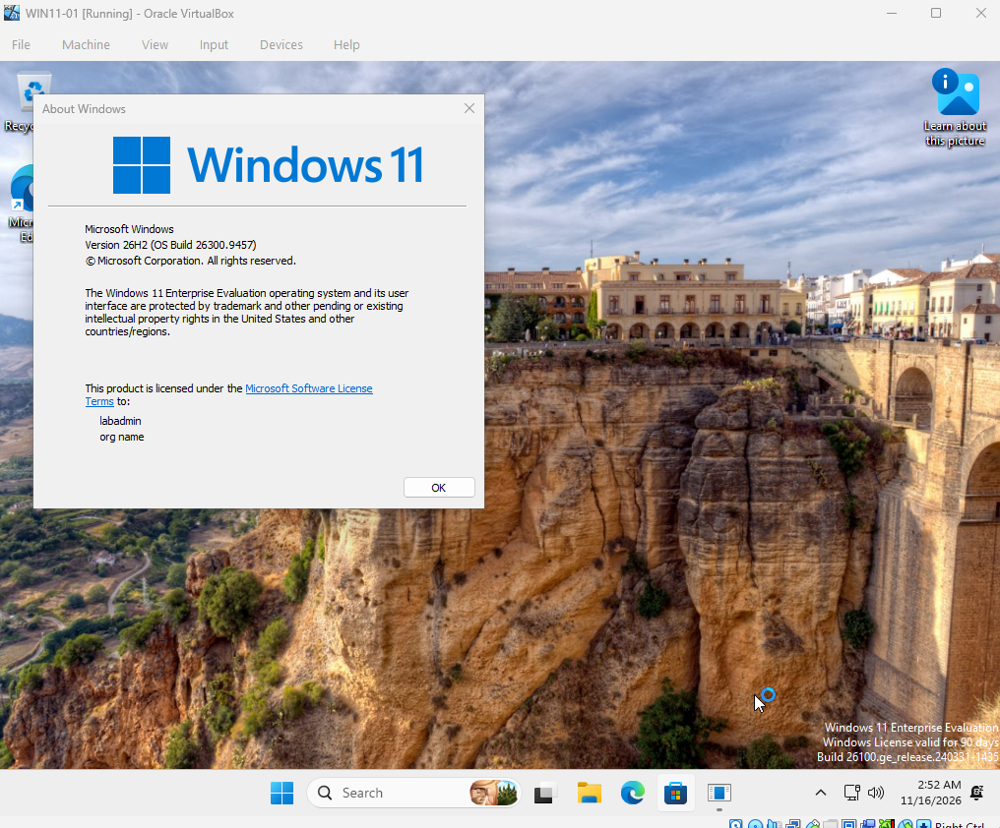
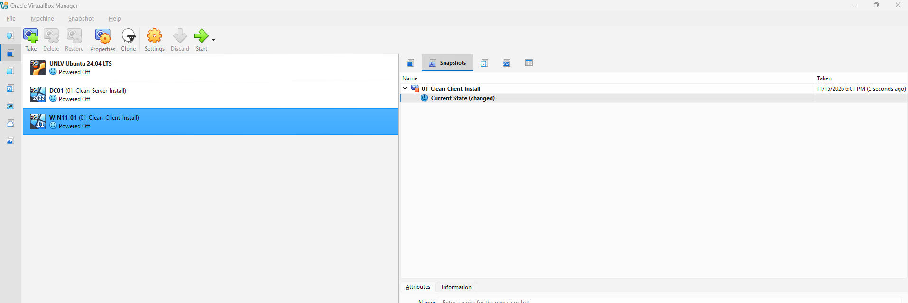
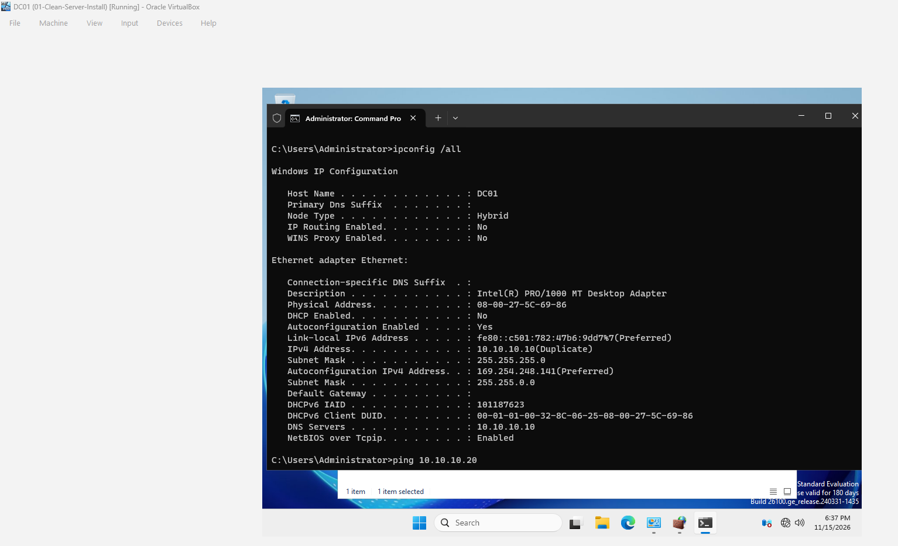
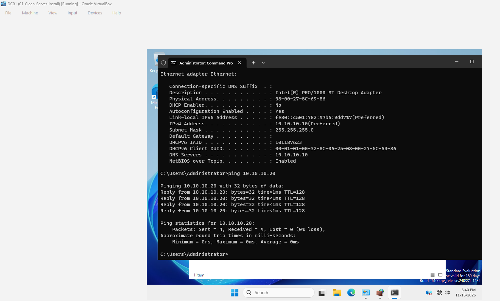

# Screenshot Evidence

Selected screenshots supplied by the lab owner, reviewed before publication. They show lab machines, fictional/local account names, and private lab addressing. Activation-page screenshots with product identifiers, host personal paths, and unrelated application views are omitted. Images are original screenshots, not recreated outputs. Capture timestamps are not used to infer task order or completion dates.

## Windows Server installation

About Windows identifies Windows Server 2025 Standard Evaluation, version 24H2, build 26100.32230. The graphical session demonstrates Desktop Experience.

## Windows client installation

About Windows identifies Windows 11 Enterprise Evaluation, version 26H2, build 26300.9457. The registered user is labadmin; separate Settings screenshots verified the local account and activation. Client Windows updates were deferred.

## Client virtual hardware

The VM summary verifies 8192 MB RAM, 2 CPUs, TPM 2.0, EFI, Secure Boot, an 80 GB VDI, and attached Enterprise evaluation ISO. NAT shown here is the earlier installation/activation configuration, not the final lab network.

## Recovery snapshots

The client snapshot tree shows 01-Clean-Client-Install. The machine list also shows DC01 associated with 01-Clean-Server-Install; both VMs are powered off. These screenshots establish snapshot existence, not successful restoration.

## Isolated networking

DC01's summary shows adapter 1 attached to Internal Network LabNet. Later read-only inspection of the current configuration for both VMs confirmed their active adapters use LabNet; historical snapshot configurations were excluded from that check.

## Client static addressing

WIN11-01's ipconfig /all shows 10.10.10.20 Preferred, mask 255.255.255.0, DHCP disabled, DNS 10.10.10.10, and no gateway. This image alone does not verify reachability.

## Troubleshooting: duplicate address and failed reachability

DC01 initially reports 10.10.10.10 Duplicate and an additional 169.254 address. The client test to 10.10.10.10 fails; Destination host unreachable is returned by the client itself, not the server. The source of the detected conflict has not been established.

## Recovery: server-to-client success

A subsequent DC01 screenshot shows 10.10.10.10 Preferred and four successful replies from WIN11-01 at 10.10.10.20 with 0% loss. Adapter disable/enable had been suggested; the learner did not explicitly identify which action restored the address, so causation is not claimed.

## Verification limit: a self-ping is not a remote connectivity test

This client screenshot shows the earlier failed ping to the server, followed by a successful ping to its own address 10.10.10.20. The self-ping verifies local response only. A new WIN11-01 ping to 10.10.10.10 is still required before claiming successful tests initiated in both directions.

