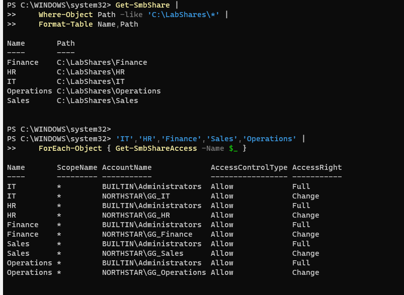

# Department file shares

Five SMB shares are verified on DC01:

| Share | Local path | Department group |
|---|---|---|
| IT | C:\LabShares\IT | NORTHSTAR\GG_IT |
| HR | C:\LabShares\HR | NORTHSTAR\GG_HR |
| Finance | C:\LabShares\Finance | NORTHSTAR\GG_Finance |
| Sales | C:\LabShares\Sales | NORTHSTAR\GG_Sales |
| Operations | C:\LabShares\Operations | NORTHSTAR\GG_Operations |

Each share ACL grants Administrators Full Control and the matching department group Change. Everyone is absent. These are share-level settings; NTFS ACLs and actual allowed/denied employee access remain unverified. DNS remains unresolved and the client is not verified domain-joined.

## Permission verification

All five NTFS ACLs are verified: Administrators/SYSTEM Full Control and the matching department group Modify, with broad Users entries removed. From WIN11-01, Jamie Chen can create/read a file in IT, while listing HR is denied. DC01 confirms the SMB identity NORTHSTAR\jamie.chen from 10.10.10.20. HR mapping success alone did not demonstrate file access. See the [full evidence](EVIDENCE.md#verified-share-and-ntfs-permissions). These IP-based SMB tests do not establish healthy DNS or client domain membership.
