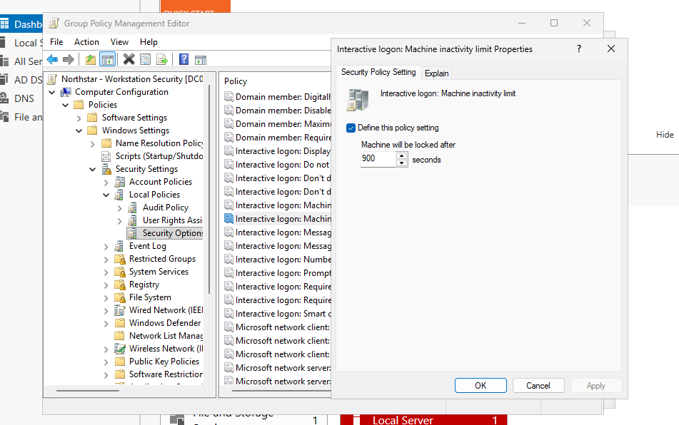
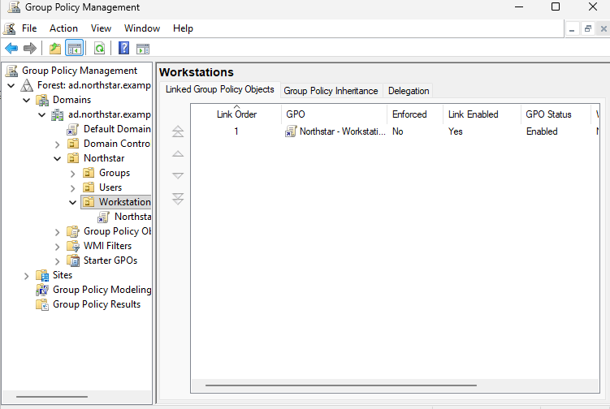

# Workstation Group Policy

The Northstar - Workstation Security GPO is created and linked to Northstar/Workstations. The link is enabled, the GPO status is Enabled, and Enforced is No.

Computer Configuration > Policies > Windows Settings > Security Settings > Local Policies > Security Options > Interactive logon: Machine inactivity limit is defined as 900 seconds (15 minutes).

This verifies policy configuration and linking, not client application or observed locking. WIN11-01 domain join and placement in Workstations are pending. DNS remains unresolved. Default policies were not part of this task. Effective policy results, restart needs, and lock behavior still require testing on the client.
